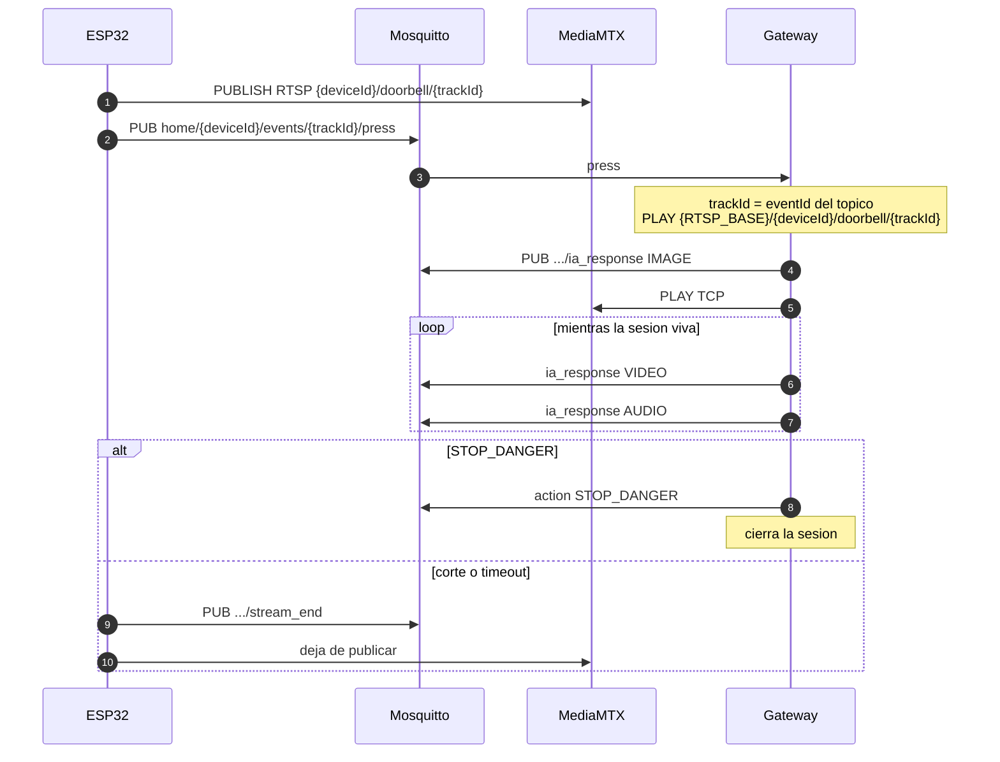

# Contrato ESP32 y gateway

Contrato que tiene que cumplir el firmware del timbre (ESP32) para hablar con `gateway-microcontroller`. Solo MQTT y RTSP. El gateway no distingue si el publicador RTSP es un ESP32, OBS o FFmpeg.

Mosquitto y MediaMTX no viven en este repo. El ESP32 y el gateway se conectan al mismo broker MQTT. El ESP32 publica RTSP a `{RTSP_BASE}/{deviceId}/doorbell/{trackId}`; el gateway arma esa URL y hace PLAY. El firmware no manda `rtspUrl`.

```
ESP32                         Infra                         Gateway
 MQTT PUB  -----------------> Mosquitto :1883 <---------- MQTT SUB/PUB
 RTSP PUB  -----------------> MediaMTX  :8554 ----------> RTSP PLAY (FFmpeg)
```

## 1. Planos

| Plano   | Transporte                         | Rol del ESP32              | Contenido              |
|---------|------------------------------------|----------------------------|------------------------|
| Control | MQTT, JSON UTF-8, QoS 1, no retain | Publica y se suscribe      | Timbre, fin, ordenes   |
| Media   | RTSP/RTP (el gateway usa TCP)      | Publica el live            | Video y audio en vivo  |

El ESP32 no manda chunks de video ni audio por MQTT. El gateway se suscribe a `home/+/events/#` y descarta tópicos que no sean `press`, `stream_end` o `capture_*`.

## 2. Topicos

Convencion: `home/{deviceId}/events/{trackId}/{accion}`. El ESP32 genera `eventId` (= `trackId`) **antes** del press. No hay `press_ack`. Orden: publicar RTSP a ese path, despues MQTT press. La identidad de la llamada es solo el **topico**. Los bodies MQTT no llevan `deviceId`, `eventId` ni `trackId`.

Status/telemetry (si se cablean) viven en `home/{deviceId}/status`, no bajo un `trackId`.

### El ESP32 publica (el gateway escucha)

| Topico | Obligatorio | Uso |
|--------|-------------|-----|
| `home/{deviceId}/events/{trackId}/press` | Si | Inicio de llamada |
| `home/{deviceId}/events/{trackId}/stream_end` | Recomendado | Cierre de esa llamada |
| `home/{deviceId}/events/{trackId}/capture_image` | No | JPEG puntual desde RTSP |
| `home/{deviceId}/events/{trackId}/capture_audio` | No | Audio puntual desde RTSP |

### El ESP32 se suscribe (el gateway publica)

| Topico | QoS | Uso |
|--------|-----|-----|
| `home/{deviceId}/events/{trackId}/ia_response` | 1 | Instruccion de **esa** llamada despues de cada analisis |

No hace falta implementar: `home/{deviceId}/status`, `home/{deviceId}/telemetry`, ni media binaria por MQTT. El firmware no se suscribe a un `ia_response` global.

## 3. Flujo minimo (timbre)



Reglas:

1. El stream RTSP tiene que estar listo para PLAY **antes** del `press`. Si el path no existe, FFmpeg falla el DESCRIBE (404) y no hay VIDEO/AUDIO.
2. `eventId` del press es el `trackId` de toda la sesion. El ESP32 lo genera; el gateway no lo asigna. El mismo valor va en el topico de `press`, `stream_end` e `ia_response`, no en el JSON.
3. Un press nuevo para el mismo `deviceId` cancela la sesion anterior de **ese** dispositivo. Un press de otro `deviceId` no la toca.
4. Un press con el mismo `deviceId` y el mismo `eventId` que la sesion activa se ignora.
5. Un `stream_end` o un publisher RTSP con el mismo `deviceId` y **otro** `trackId` no corta ni pisa la llamada activa.
6. La sesion tambien caduca por `SESSION_TTL` del gateway (default 30s). Ese TTL no se extiende con media.

## 4. MQTT press

Topico: `home/{deviceId}/events/{trackId}/press`. QoS 1. JSON.

| Campo | Tipo | Obligatorio | Notas |
|-------|------|-------------|-------|
| `timestamp` | number | No | Epoch milisegundos UTC |
| `event` | string | No | Convencion: `"press"` |
| `image` | string | No | JPEG en Base64. Si falta, el gateway saca un frame por RTSP |
| `batteryPercentage` | number | No | Informativo |

El JSON **no** lleva `deviceId`, `eventId` ni `rtspUrl`. El gateway toma la identidad del topico y arma `{RTSP_BASE}/{deviceId}/doorbell/{trackId}`.

Ejemplo:

```json
{
  "timestamp": 1730000000123,
  "event": "press",
  "image": "/9j/4AAQSkZJRgABAQAAAQABAAD...",
  "batteryPercentage": 94.5
}
```

## 5. MQTT stream_end

Topico: `home/{deviceId}/events/{trackId}/stream_end`. QoS 1. JSON. El topico ya dice que llamada termina; el body no lleva identidad.

| Campo | Tipo | Obligatorio | Notas |
|-------|------|-------------|-------|
| `timestamp` | number | No | Epoch ms |

Si el `{trackId}` del topico no coincide con la sesion actual, no se cierra. Un `stream_end` de otro `deviceId` no toca esta llamada.

Ejemplo:

```json
{
  "timestamp": 1730000030000
}
```

Despues de este mensaje el ESP32 deja de publicar RTSP.

## 6. MQTT ia_response (gateway hacia el ESP32)

Topico: `home/{deviceId}/events/{trackId}/ia_response`. QoS 1. No retained.

El gateway publica esto despues de cada analisis (snapshot, cada video, cada audio) **solo** en el topico de esa llamada.

| Campo | Tipo | Valores |
|-------|------|---------|
| `messageId` | string UUID | Unico por publicacion. Si el ESP32 ve el mismo `messageId` dos veces, es reentrega MQTT (QoS 1), no dos analisis |
| `chunkType` | string | `IMAGE`, `VIDEO` o `AUDIO` |
| `action` | string | `CONTINUE` o `STOP_DANGER` |
| `severity` | string | El `finalSeverity` del orquestador (p. ej. `PELIGROSO`, `NORMAL`) |
| `message` | string | Texto para UI, log o TTS |

El JSON **no** lleva `deviceId` ni `trackId`. Van en el topico.

Ejemplo CONTINUE:

```json
{
  "messageId": "7f1a2c3e-4b5d-6789-abcd-ef0123456789",
  "chunkType": "VIDEO",
  "action": "CONTINUE",
  "severity": "LOW",
  "message": "No se detectaron senales de peligro."
}
```

Ejemplo STOP_DANGER:

```json
{
  "messageId": "8a2b3c4d-5e6f-7890-abcd-ef0123456789",
  "chunkType": "AUDIO",
  "action": "STOP_DANGER",
  "severity": "PELIGROSO",
  "message": "No se reconoce a la persona"
}
```

En el firmware:

- `CONTINUE`: seguir publicando RTSP. No hace falta otro press.
- `STOP_DANGER`: cortar RTSP y disparar la alerta local. El gateway ya cerro la sesion.

El firmware se suscribe a `home/{suDeviceId}/events/{esteTrackId}/ia_response`. No filtra por campos de identidad en el JSON.

## 7. Captura on-demand (opcional)

No es el flujo de timbre. El gateway igual esta suscripto.

Topicos: `home/{deviceId}/events/{trackId}/capture_image` y `.../capture_audio`.

```json
{
  "timestamp": 1730000010000
}
```

Si hay sesion activa para ese `deviceId` y `trackId`, se reutiliza su URL RTSP. Si no, el gateway arma la misma regla `{RTSP_BASE}/{deviceId}/doorbell/{trackId}`. No hace falta `rtspUrl` en el JSON.

## 8. RTSP

El gateway se conecta con FFmpeg:

- transporte `rtsp_transport=tcp`
- timeout de handshake ~10 s
- video: primer track `0:v:0`, ventanas (default 5 s) a MP4 H.264
- audio: primer track `0:a:0`, ventanas (default 10 s) a MP3 o WAV, mono 16 kHz

El live tiene que cumplir:

1. Path `{deviceId}/doorbell/{trackId}` en estado ready **antes** del press.
2. Pista de video. H.264 yuv420p es lo mas compatible.
3. Pista de audio si se espera analisis de audio (G.711, PCM o AAC). Sin audio, VIDEO puede seguir; AUDIO falla y reintenta.
4. Un solo publicador por path. Otro `trackId` es otro path: no pisa la llamada activa.
5. Al terminar: unpublish para no dejar el path zombie.

Convencion: PLAY `rtsp://<host-mediamtx>:8554/{deviceId}/doorbell/{trackId}`. El host lo configura el operador en `RTSP_BASE` del gateway; el ESP32 solo conoce el path.

El ESP32 publica hacia MediaMTX (RTSP publish o RTMP si esta habilitado). El gateway nunca publica; solo hace PLAY.

## 9. Broker MQTT

- Misma host/puerto que usa el gateway, tipico `tcp://<host>:1883`.
- QoS 1 en press, stream_end e ia_response.
- Client ID unico por dispositivo (no usar `gateway-micro`).
- JSON UTF-8 valido. `image` es Base64 estandar, JPEG.
- Sin retain en press, stream_end ni ia_response: un press retained reabriria la sesion en cada reconnect del gateway.

## 10. Checklist firmware

- Publica video y audio RTSP al path `{deviceId}/doorbell/{trackId}` **antes** del press.
- `press` en `home/{deviceId}/events/{trackId}/press` (sin `deviceId`, `eventId` ni `rtspUrl` en el JSON).
- JPEG Base64 opcional pero recomendado.
- Suscripto a `home/{deviceId}/events/{trackId}/ia_response`.
- Ante `STOP_DANGER` corta el stream.
- Publica `stream_end` en el mismo arbol de topicos al terminar.
- No envia media binaria por MQTT.
- `deviceId` estable; `eventId` nuevo en cada llamada.
